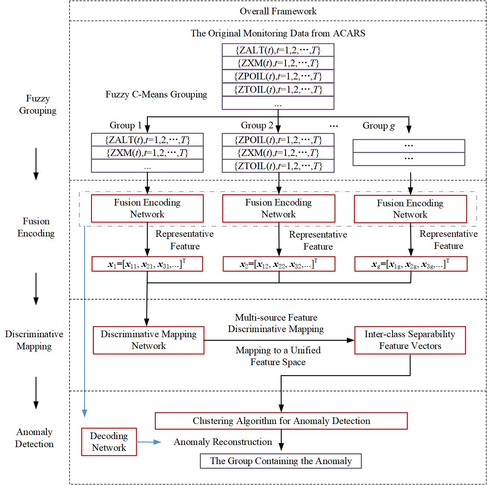
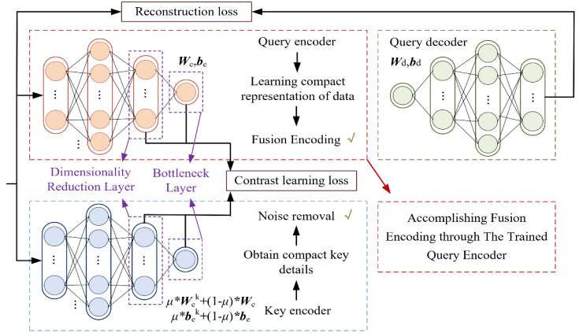
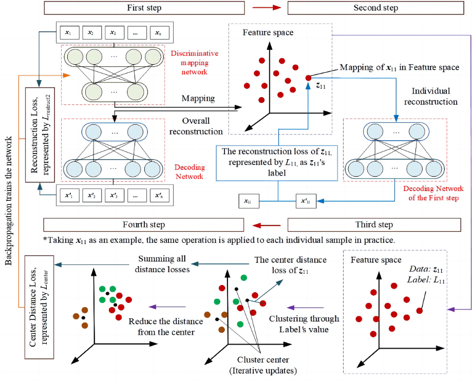
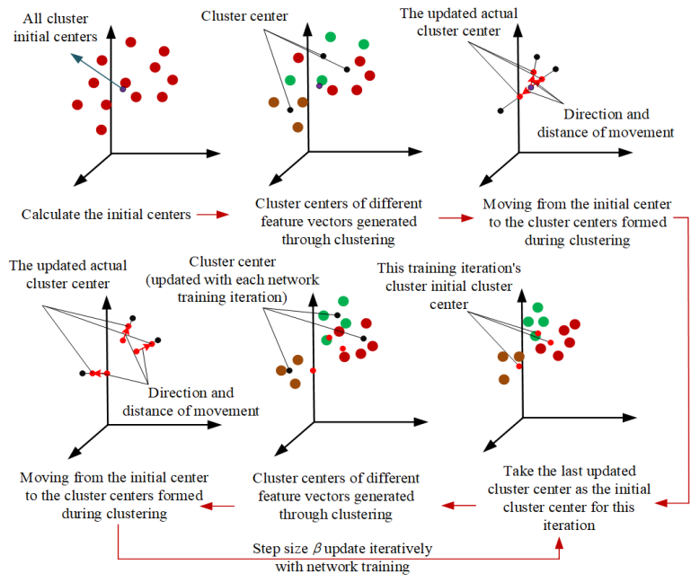

# FFD-Clustering

**基于变量模糊融合与特征判别映射的航空发动机无监督异常检测方法**

[English](README.md) | [简体中文](README.zh-CN.md)

本项目实现以下论文提出的 FFD-Clustering 方法框架：

Wang, Z., Fu, X., Zhao, M., Xia, X., & Zhong, S. (2025). [*FFD-Clustering: An unsupervised anomaly detection method for aero-engines based on fuzzy fusion of variables and discriminative mapping of features*](https://doi.org/10.1016/j.cja.2024.103346). *Chinese Journal of Aeronautics, 38*(5), 103346.

## 总体框架

<p align="center">
  
</p>

*图 1. FFD-Clustering 总体框架（引自上述论文）。*

## 方法

FFD-Clustering 包含四个阶段：

1. **模糊变量分组（Fuzzy Grouping，FG）。** 采用 K-means 初始化的模糊 C 均值聚类（FCM），根据模糊隶属度将相关监测变量划分为允许重叠的变量组；利用划分系数（PC）与分类熵（CE）辅助确定分组数量。
2. **特征融合编码网络（Fusion Encoding Network，FEN）。** 通过查询编码器、键编码器与查询解码器，在各变量组内结合重构学习和多层对比学习，提取代表性特征。
3. **特征判别映射网络（Discriminative Mapping Network，DMN）。** 利用重构误差再聚类，引导不同变量组的特征映射到统一特征空间。
4. **异常检测（Anomaly Detection）。** 在映射后的特征空间中采用 K-means 聚类。异常分数定义为特征向量到最近聚类中心的欧氏距离：

   $$
   s(\mathbf z_i) = \min_{k} \|\mathbf z_i - \mathbf c_k\|_2.
   $$

   根据训练集异常分数的分位数设置二分类阈值；利用 FEN 解码器的重构结果，对关联变量组进行异常定位与排序。

### 特征融合编码网络（FEN）

各模糊变量组分别通过特征融合编码网络提取代表性特征。网络包含查询编码器、键编码器和查询解码器，通过重构损失与对比学习约束查询网络；键编码器为对比学习提供特征表示。

<p align="center">
  
</p>

*图 5. 基于多层对比降噪的特征融合编码网络（引自上述论文）。*

### 特征判别映射网络（DMN）

各变量组的代表性特征映射至统一特征空间。DMN 训练过程结合整体重构、基于重构误差的再聚类和中心距离损失。

<p align="center">
  
</p>

*图 8. 基于重构差异再聚类的判别映射训练四步骤（引自上述论文）。*

在 DMN 训练过程中，聚类中心逐步更新，以提高特征映射训练的稳定性。

<p align="center">
  
</p>

*图 9. DMN 训练过程中的动态聚类中心更新（引自上述论文）。*

## 环境安装

需要 Python 3.10 或更高版本。

```bash
python -m pip install -r requirements.txt
```

## 使用方法

准备训练和测试 CSV 文件，两份文件必须具有相同的数值型监测参数列，且列顺序一致。输入文件不应包含标签列或时间戳列。

```bash
python run.py --train-csv train.csv --test-csv test.csv --groups 6 --clusters 4 --contamination 0.05
```

`--groups` 指定模糊变量组数量，`--clusters` 指定 K-means 聚类数量。添加 `--scan-groups` 可导出不同候选分组数量的 PC 与 CE 指标。`--contamination` 表示预设异常比例，用于根据训练集异常分数确定检测阈值。

使用 `--output-dir` 可指定输出路径（默认为 `outputs/run/`）。程序会保存训练模型、模糊隶属度、映射特征、异常分数、二分类检测结果以及异常变量组定位结果。

## 论文引用

```bibtex
@article{wang2025ffd,
  title={FFD-Clustering: An unsupervised anomaly detection method for aero-engines based on fuzzy fusion of variables and discriminative mapping of features},
  author={Wang, Zhe and Fu, Xuyun and Zhao, Minghang and Xia, Xiangzhao and Zhong, Shisheng},
  journal={Chinese Journal of Aeronautics},
  volume={38},
  number={5},
  pages={103346},
  year={2025},
  doi={10.1016/j.cja.2024.103346}
}
```
